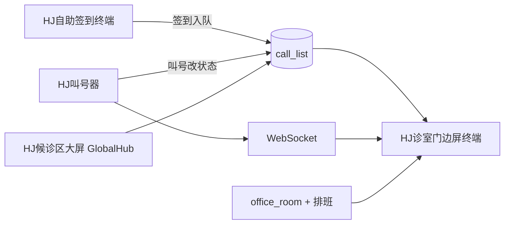

# HJ诊室门边屏终端需求说明书

> **文档位置：** `docs/business/requirements/` · 需求变更请同步更新本文档（索引见 [docs/README.md](../../README.md)）

**版本：** v1.0  
**日期：** 2026-06-03  
**状态：** 草案  
**关联项目：** QueueNumberCalling / **HJ诊室门边屏终端**（仓库目录 `HJ诊室门边屏终端`）  

---

## 1. 背景与目标

### 1.1 背景

现有终端包括：

| 终端 | 项目 | 场景 |
|------|------|------|
| 候诊区大屏 | `HJ候诊区大屏` | 候诊区全院/多诊室汇总叫号 |
| 自助签到 | `HJ自助签到终端` | 患者扫码/输入签到码入队 |
| 叫号器 | `HJ叫号器` | 窗口叫号、过号、完成等操作 |

**缺失能力：** 各诊室门口显示屏，用于展示该诊室坐诊医生、当前就诊患者、等候患者，方便患者确认「是否进对门」。

### 1.2 目标

- 在 **`HJ诊室门边屏终端`** 目录下独立建设 **HJ诊室门边屏终端** 前端（Vue 3 + Vite + TypeScript，技术栈对齐 HJ自助签到终端）。
- 实现 **9:16 竖屏** 展示界面，视觉风格参考 `HJ自助签到终端`。
- 支持 **单医生 / 双医生** 两种布局。
- 功能为系统 **必需能力**（可验收、可联调），但 **现场可能不部署硬件**（需兼容未部署场景）。
- 与后端 `pdjh-server` 对接，以 **物理诊室（office_room）** 为数据锚点。

### 1.3 非目标

- 不在诊室屏上实现签到、叫号、触摸配置等交互。
- 不替代候诊区叫号大屏（**HJ候诊区大屏** / GlobalHub）。
- 不替代叫号器（**HJ叫号器**）。

---

## 2. 术语定义

| 术语 | 对应实体 | 说明 |
|------|----------|------|
| 诊区 | `department`（树节点） | 业务/队列维度，可有父子结构（`father_id`） |
| 科室 | `department` | 与诊区同表，按层级区分业务归属 |
| 物理诊室 | `office_room` | 固定门牌位置，如「内科一诊室 101」 |
| 医生档案 | `doctor` | 姓名、职称、头像、专长等静态信息 |
| 当日坐诊 | `doctor_schedule` / `room_duty`（待扩展） | 医生「今天在哪个诊区、哪间诊室」 |
| 排队记录 | `call_list` | 含 `dept_id`、`office_room_id`、`doctor_id` |
| 门边屏 | `doc_screen` + `screen_room_mapping` | 硬件终端，绑定到物理诊室 |

---

## 3. 数据模型与绑定原则

### 3.1 核心原则（三层分离）

```
诊区/科室 (department)  →  管排队、分诊、统计（医生可轮换）
物理诊室 (office_room)  →  管门牌、门边屏硬件（固定）
当日坐诊会话            →  管「今天谁在哪个诊室」（每天可变）
```

**结论：**

- **门边屏绑定诊室**，不绑定诊区。
- **医生不静态绑定**诊区或诊室；档案可有所属科室，当日展示以 **排班/坐诊会话** 为准。
- 医生跨诊区轮换时，改排班中的 `dept_id` + `office_room_id`；门边屏因绑在诊室上，自动显示当日该室坐诊医生。

### 3.2 绑定关系

| 关系 | 方式 | 是否可变 |
|------|------|----------|
| 门边屏 ↔ 诊室 | `screen_room_mapping(screen_id, office_room_id)` | 固定 |
| 门边屏启动 | URL `deviceCode` → `doc_screen` → 上述映射 | — |
| 诊室 ↔ 诊区 | `office_room.dept_id` | 较固定 |
| 医生 ↔ 诊区（队列） | `doctor_schedule.dept_id` / `call_list.dept_id` | 按日 |
| 医生 ↔ 诊室（当日） | `doctor_schedule.office_room_id`（待增）或 `room_duty` | 按日 |
| 患者 ↔ 诊室 | `call_list.office_room_id` | 运行时 |

### 3.3 双医生同室

- 同一诊室最多 **2 名** 医生同时坐诊。
- 建议新增 `office_room_doctor(room_id, doctor_id, sort_order)`，或在排班表支持同室多人。
- 队列仍按 `office_room_id` 查询；「正在就诊」可按 `doctor_id` 区分归属。

### 3.4 后端待扩展项

| 优先级 | 项 | 说明 |
|--------|-----|------|
| P0 | `GET /api/ClinicScreen/GetDisplay?deviceCode=` | 聚合：诊室 + 当日医生 + 当前/等候队列 + 公告 |
| P0 | 门边屏一屏一室 | `screen_room_mapping` 一对一（门口屏场景） |
| P1 | `doctor_schedule.office_room_id` 或 `room_duty` 表 | 支持医生轮换、跨诊区 |
| P1 | `office_room_doctor` | 支持双医生同室 |
| P1 | `CallListScreenService` 返回 `Doctors` 字段 | 兼容旧前端 |
| P2 | STOMP `/topic/room/{roomId}` | 诊室级精准推送（可选） |

---

## 4. 功能需求

### 4.1 终端识别与配置（FR-01）

- 启动参数：`?deviceCode=xxx`（与 HJ自助签到终端一致）。
- 可选：`localStorage` 缓存、`VITE_DEVICE_ID` 环境变量（开发用）。
- 调用后端获取：绑定诊室、屏幕公告、刷新间隔、启用状态。
- **未配置 / 未绑定 / 已停用** 时进入待机页，不白屏、不阻塞其他终端。

### 4.2 待机与可选部署（FR-02）

**原则：** 能力必需，部署可选。

| 状态 | 表现 |
|------|------|
| 无 deviceCode | 待机页：「未配置设备编号」 |
| 设备未注册 | 待机页：「设备未注册，请联系管理员」 |
| 未绑定诊室 | 待机页：「尚未绑定物理诊室」 |
| 屏幕已冻结 | 待机页：「设备已停用」 |
| 正常 | 展示诊室信息 |

待机页需提示：「请到候诊区留意叫号信息」，**不影响**签到、大屏、医生站主流程。

### 4.3 诊室信息展示（FR-03）

顶栏展示：

- 医院名称（可配置 `VITE_HOSPITAL_NAME`）
- 诊室名称（`office_room.name`）
- 所属诊区/科室名（`department.name`）
- 当前日期、时间（每秒刷新）

### 4.4 医生信息展示（FR-04）

数据来源优先级：

1. 当日坐诊会话 / `office_room_doctor`
2. `office_room.doctor_id`（缓存/默认）
3. 兜底：当日该诊室 `call_list` 中去重 `doctor_id`

#### 4.4.1 单医生模式（doctors.length === 1）

展示：

- 头像、姓名、职称
- 出诊状态（出诊中 / 停诊）
- **介绍、擅长**（`doctor.specialty` 等，可扩展 intro 字段）

#### 4.4.2 双医生模式（doctors.length === 2）

展示：

- 左右并列紧凑卡片：头像、姓名、职称、出诊状态
- **不展示** 介绍、擅长（节省空间）

#### 4.4.3 无值班

展示：「暂无值班」或「正在等待排班同步」，队列区仍可展示（若有数据）。头像占位缺省字为「值」。

### 4.5 正在就诊（FR-05）

- 数据：`call_list` 中 `state = 1` 且 `office_room_id` = 本屏绑定诊室。
- 双医生：最多 2 行，按 `doctor_id` 各显示 1 位当前就诊患者。
- 展示：序号（`xh` / `showNo`）、**脱敏姓名**。
- 空态：「当前暂无人就诊」。

姓名脱敏规则（与 HJ候诊区大屏 pdjh2 一致）：

- 2 字：`张 *`
- 3 字：`张 * 三`
- 4 字及以上：保留首字，其余 `*`

### 4.6 等候就诊（FR-06）

- 数据：`call_list` 中 `state = 0`（含 WAITING / REVISIT）且 `office_room_id` = 本室。
- 默认展示 **6～8 人**，超出可自动轮播（无需触摸）。
- 展示：序号 + 脱敏姓名；双医生时可带医生简称标签（可选）。
- 空态：「暂无等候人员」。

### 4.7 公告栏（FR-07）

- 滚动显示 `doc_screen.bulletin`。
- 默认文案：「请遵守次序，文明就诊。」
- 叫号广播时可在底部短暂显示叫号字幕（可选，可配置关闭）。

### 4.8 数据刷新（FR-08）

- **轮询（必需）：** 默认每 5s（可配置 `scrollTime`），拉取队列与坐诊信息。
- **WebSocket（可选）：** 订阅 STOMP `/topic/hall`，收到 `CALL_MSG` / `STATE_UPDATE` 后立即刷新。
- WebSocket 不可用时 **静默降级** 为纯轮询，不弹错。

### 4.9 语音播报（FR-09，可选）

- 若门口屏带扬声器，可播放叫号 TTS/音频（与 HJ候诊区大屏 pdjh2 类似）。
- 默认 **关闭**；未部署硬件时不启用。
- 全院大屏继续承担主叫号语音职责。

---

## 5. 界面需求

### 5.1 尺寸与适配（UI-01）

- 设计稿固定 **9:16**，基准 **450 × 800 px**（与 HJ自助签到终端 SignIn.vue 一致）。
- 使用 `transform: scale()` 等比缩放至任意物理屏，居中显示。
- 不支持横屏布局；竖屏唯一方案。

### 5.2 视觉规范（UI-02，参考 HJ自助签到终端）

| 设计 token | 值 |
|------------|-----|
| 主色 | `#1677ff` |
| 主色浅 | `#4096ff` |
| 主色深 | `#0958d9` |
| 背景渐变 | `#dceaff → #edf4ff → #f8fbff → #ffffff` |
| 卡片 | 白底、圆角 18～24px、`--shadow-card` |
| 顶栏 | 毛玻璃效果（backdrop-filter） |
| 字体 | PingFang SC / Microsoft YaHei |

### 5.3 布局结构（UI-03）

**单医生（450×800 约比）：**

```
┌─────────────────────┐  ~10%   顶栏
├─────────────────────┤  ~22%   医生区（含介绍/擅长）
├─────────────────────┤  ~28%   正在就诊
├─────────────────────┤  ~32%   等候就诊
├─────────────────────┤  ~8%    公告
└─────────────────────┘
```

**双医生：**

```
┌─────────────────────┐  顶栏
├──────────┬──────────┤  双医生紧凑卡（无介绍/擅长）
├──────────┴──────────┤  正在就诊（1～2 行）
├─────────────────────┤  等候列表
├─────────────────────┤  公告
└─────────────────────┘
```

### 5.4 交互（UI-04）

- **零触摸**：纯展示，无按钮、无键盘、无登录。
- 不依赖用户操作完成任何业务流程。

---

## 6. 接口需求

### 6.1 聚合接口（推荐，P0）

**`GET /api/ClinicScreen/GetDisplay`**

| 参数 | 必填 | 说明 |
|------|------|------|
| deviceCode | 是 | 设备唯一码 |

**响应示例：**

```json
{
  "success": true,
  "data": {
    "screen": {
      "id": "SCR_ROOM_01",
      "state": 1,
      "bulletin": "请遵守次序，文明就诊。",
      "scrollIntervalSec": 5
    },
    "room": {
      "id": "ROOM001",
      "name": "内科一诊室",
      "deptId": "DEPT001",
      "deptName": "内科门诊",
      "floor": "1F",
      "roomNo": "101"
    },
    "doctors": [
      {
        "id": "DOC001",
        "name": "李医生",
        "title": "主治医师",
        "avatar": "",
        "specialty": "擅长……",
        "isOnDuty": 1
      }
    ],
    "currentPatients": [
      {
        "doctorId": "DOC001",
        "showNo": "A012",
        "xh": 12,
        "patientName": "张*三",
        "state": 1
      }
    ],
    "waitingPatients": [
      { "showNo": "A013", "xh": 13, "patientName": "王*", "doctorId": "DOC001" }
    ]
  }
}
```

### 6.2 兼容接口（过渡期）

在未实现聚合接口前，可组合调用：

| 接口 | 用途 |
|------|------|
| `POST /Screens/GetScreensInput` | 屏幕配置、roomInfo |
| `POST /CallList/GetCallListInput` | 就诊中 |
| `POST /CallList/GetCallListInputPage` | 等候分页 |
| `POST /Doctor/GetByDept` 等 | 医生档案 |

### 6.3 实时通道

- STOMP over SockJS，订阅 `/topic/hall`（与 HJ候诊区大屏一致）。
- 消息类型：`CALL_MSG`、`STATE_UPDATE`；按 `code` / `office_room_id` 过滤本室。

---

## 7. 项目结构需求

所有代码位于 **`HJ诊室门边屏终端/`** 目录：

```
HJ诊室门边屏终端/
├── package.json
├── vite.config.ts              # dev 端口建议 5175，proxy /api
├── index.html
└── src/
    ├── main.ts
    ├── App.vue
    ├── router/index.ts         # 单路由 → ClinicScreen
    ├── views/ClinicScreen.vue
    ├── components/
    │   ├── ScreenFrame.vue     # 9:16 scale 壳
    │   ├── TopBar.vue
    │   ├── DoctorSingle.vue
    │   ├── DoctorDual.vue
    │   ├── CurrentPatient.vue
    │   ├── WaitingList.vue
    │   ├── BulletinBar.vue
    │   └── StandbyView.vue
    ├── api/clinicScreen.ts
    ├── composables/
    │   ├── useDeviceBinding.ts
    │   ├── useQueuePoll.ts
    │   └── useScreenScale.ts
    └── utils/desensitize.ts
```

**不**在 `HJ候诊区大屏/pdjh2` 中扩展（旧版横屏模板，差异过大）。

---

## 8. 管理后台配置需求

实施人员需在 **HJ管理后台** 完成：

| 步骤 | 菜单 | 操作 |
|------|------|------|
| 1 | 院内业务树 → 物理诊室 | 创建诊室，关联诊区 `dept_id` |
| 2 | 设备与屏幕 → 屏幕管理 | 注册门边屏，填写 `deviceCode` |
| 3 | 屏幕管理 → 诊室绑定 | `screen_room_mapping` 绑定 **一个** 诊室 |
| 4 | 医生管理与档案 | 维护医生信息（头像、职称、专长） |
| 5 | 排班（待建设） | 配置当日医生 ↔ 诊室 ↔ 诊区 |
| 6 | 双医生（待建设） | 同室绑定 2 名医生 |

对应实施清单项：**STEP4_SMALLSCREEN - 诊区诊室门口单一呼叫屏挂载**。

---

## 9. 与其他终端的关系



| 场景 | 诊室屏未部署时 |
|------|----------------|
| 患者签到 | 正常 |
| 候诊区叫号 | 正常 |
| 医生叫号 | 正常 |
| 门口确认医生/当前号 | 依赖大屏 + 语音，无门口屏 |

---

## 10. 非功能需求

| 编号 | 要求 |
|------|------|
| NFR-01 | 7×24 运行，断网自动重连，轮询兜底 |
| NFR-02 | 首屏加载 ≤ 3s（局域网） |
| NFR-03 | 患者姓名必须脱敏展示 |
| NFR-04 | 未部署时不影响系统验收（待机页即可通过联调） |
| NFR-05 | 浏览器 Kiosk 全屏部署（Android 屏 / Mini PC） |
| NFR-06 | 访问路径示例：`http://host/clinic/#/?deviceCode=ROOM_SCREEN_01` |

---

## 11. 验收标准

### 11.1 功能验收

- [ ] 配置 `deviceCode` 后正确显示绑定诊室名称
- [ ] 单医生：展示头像、姓名、职称、介绍/擅长、出诊状态
- [ ] 双医生：双栏布局，**不**展示介绍/擅长
- [ ] 正在就诊、等候列表与医生站叫号后 **5s 内** 更新（或 WS 即时）
- [ ] 姓名脱敏正确
- [ ] 无 deviceCode / 未绑定 / 停用时显示待机页，不崩溃
- [ ] 9:16 在 1080×1920 竖屏上无拉伸变形

### 11.2 联调验收

- [ ] 在 HJ叫号器 呼叫下一位 → 诊室屏当前/等候更新
- [ ] 患者在 HJ自助签到终端签到 → 等候列表出现（同 `office_room_id`）
- [ ] 未安装门边屏硬件时，系统全流程仍可完成 UAT

### 11.3 轮换场景（P1 排班上线后）

- [ ] 医生 A 今日在 ROOM001 坐诊，ROOM001 门边屏显示 A
- [ ] 医生 A 明日换到 ROOM002，ROOM002 门边屏显示 A，ROOM001 显示新排班医生

---

## 12. 实施优先级

| 阶段 | 内容 |
|------|------|
| **Phase 1** | HJ诊室门边屏终端脚手架 + 9:16 UI + 待机页 + deviceCode 绑定 |
| **Phase 2** | 单医生 + 当前/等候 + 轮询 + 脱敏 |
| **Phase 3** | 双医生布局 + `office_room_doctor` |
| **Phase 4** | `ClinicScreen/GetDisplay` 聚合接口 |
| **Phase 5** | WebSocket 实时 + 排班/轮换（`office_room_id` on schedule） |
| **Phase 6** | 可选语音播报 |

---

## 13. 附录

### 13.1 参考实现

- UI/scale：`HJ自助签到终端/src/views/SignIn.vue`（450×800、主题色）
- 业务逻辑参考：`HJ候诊区大屏/src/common/pdjh2/`（勿直接复用，仅参考字段与脱敏）
- 终端绑定：`pdjh-server` → `TerminalBindingServiceImpl`、`screen_room_mapping`

### 13.2 已知后端缺口

- `Department/GetDepartmentInput` 前端有调用、Java 未实现
- `doctor_schedule` 无 `office_room_id`
- `office_room` 仅单个 `doctor_id`，不支持双医生
- `CallListScreenService.toLegacyMap` 未返回 `Doctors`

---

**文档结束**
